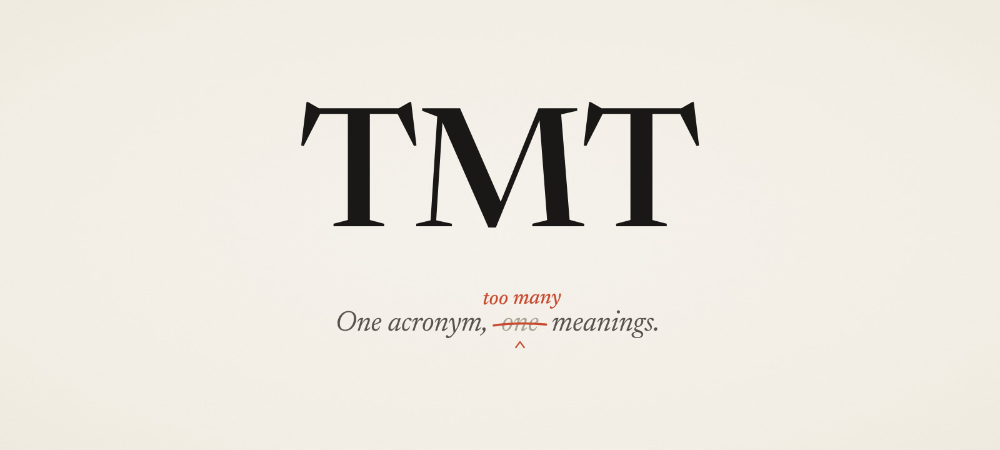

# [TMT](https://tmt.seonest.net)

_One acronym, too many meanings._

- Taking my time.
- Too many thoughts.
- Too many tabs.
- Thinking, maybe tomorrow.
- This might take...

## Development

Use Node.js 26 LTS (`26.13.0` in `.nvmrc`) and Bun to install dependencies and run scripts.
`package.json` keeps deployments on the Node.js 26 LTS line.

```sh
nvm install
nvm use
bun install --frozen-lockfile
bun run dev
```

Copy `.env.example` to `.env` and fill in the GitHub credentials before starting the app or
building it. `bun run build` refreshes the search data from GitHub and builds the site;
`bun run lint` and `bunx tsc --noEmit --incremental false` check the source.
